# CKR Schools v2 — Full-Stack Development Phases & Surface Roadmap

**Document ID:** `CKR-DOC-DEV-PHASES-V2`  
**Governing Agency:** CKR Technologies, Greater Noida, India  
**Applicability:** Full Engineering & Client Delivery Team  
**Architecture:** Multi-Tenant B2B SaaS (Node.js Express 5 ESM + PostgreSQL + React 19 Vite + React Native Bare CLI)  

---

## 1. Executive Summary & Delivery Philosophy

`ckr-schools-v2` transforms the proven functional architecture of Vision International School into a high-scale, multi-tenant B2B educational SaaS platform. 

Every feature is delivered following the **CKR Vertical Slicing Lifecycle** (`ckr-phased-implementation`):
```
Database Schema → Express 5 API Slice → Redux Toolkit + RTK Query → CKR-Standard UI Screen → E2E Verification
```
No isolated horizontal layers or mock screens are permitted.

---

## 2. High-Level Implementation Phase Map

```mermaid
flowchart TD
    subgraph P1["PHASE 1: Platform Multi-Tenancy (DONE)"]
        S1["Surface 1: Super Admin Portal<br/>• Tenant Provisioning (ACID tx)<br/>• Plan Tiers & Platform ARR<br/>• CKR 5-Standard School Table"]
    end

    subgraph P2["PHASE 2: School Core Admin & Master Data"]
        S2["Surface 2: School Operations & Master Data<br/>• 4 Live School KPIs<br/>• Class & Section Grid<br/>• Subject Directory & Rooms"]
        S3["Surface 3: People & Directory<br/>• Students & Teachers 38px Table<br/>• Student 360° Profile"]
    end

    subgraph P3["PHASE 3: Operational Desks & Money"]
        S4["Surface 4: Admissions & Onboarding Desk<br/>• Enquiries Funnel<br/>• Multi-Step KYC & Approval"]
        S5["Surface 5: Finance & Fee Counter<br/>• Dues Waterfall Engine<br/>• POS Fee Counter (UPI/Cash/Cheque)<br/>• Printable Receipts & Ledgers"]
    end

    subgraph P4["PHASE 4: Academics, Schedules & Staff"]
        S6["Surface 6: Timetable & Room Collision Engine"]
        S7["Surface 7: Academic Manager & Exams"]
        S8["Surface 8: Teachers Manager & Staff Evaluation"]
        S9["Surface 9: Transfer Certificate (TC) & Clearance"]
    end

    subgraph P5["PHASE 5: React Native Mobile Apps"]
        S10["Surface 10: Teacher Mobile App"]
        S11["Surface 11: Student & Parent Mobile App"]
    end

    subgraph P6["PHASE 6: Staging & Production Deployment"]
        S12["Surface 12: Production VPS, Nginx Wildcard & SSL"]
    end

    P1 --> P2 --> P3 --> P4 --> P5 --> P6
```



---

## 3. Detailed Surface-by-Surface Phase Breakdown

### Phase 1: Platform Super Admin & Tenant Engine
> **Status:** `COMPLETE & VERIFIED` (Live on `:5006` and `:5173`)

- **Domain Scope:** Platform governance, school campus onboarding, and plan tier subscription management.
- **Backend Endpoints:**
  - `POST /api/auth/login` (Super admin credentials verification)
  - `GET /api/superadmin/stats` (4 Platform KPIs: Schools, Students, Teachers, MRR)
  - `GET /api/superadmin/tenants` (50-row paginated schools registry)
  - `POST /api/superadmin/tenants` (ACID provisioning of tenant + default administrator)
  - `GET /api/superadmin/tenants/:id` (Dedicated school entity view)
  - `PUT /api/superadmin/tenants/:id` (Plan tier upgrade & school metadata update)
  - `PATCH /api/superadmin/tenants/:id/status` (Instant active/suspend toggle)
- **Frontend App:** `web/superadmin_portal`
  - Invariants: One-word menu (`Overview`, `Schools`, `Billing`, `Audit`), 4 interactive KPI cards, CKR 5-standard table (38px rows, `#064e3b` header, sort, CSV/PDF export, 50-row default pagination).

---

### Phase 2: School Core Operations & Academic Master Data
> **Status:** `NEXT IN QUEUE`

- **Domain Scope:** The operational foundation of the individual school tenant (`vision.ckrschools.online`).
- **User Stories:**
  - `US-201`: As a Principal, view the real-time School Radar Dashboard (Total Students, Active Teachers, Attendance Rate %, Today's Fee Collections).
  - `US-202`: As a School Admin, configure classes (Nursery to 12th) and add sections (`A`, `B`, `C`) with assigned class teachers.
  - `US-203`: As an Academic Coordinator, maintain the master Subject Directory (Code, Department, Weekly Period Quota, Compulsory/Elective status).
  - `US-204`: As an Admin, manage campus Rooms/Labs (Capacity, Facilities, Floor).
- **Backend Endpoints:**
  - `GET /api/admin_panel/stats` (4 School KPIs)
  - `GET /api/shared/classes`, `POST /api/admin_panel/classes`, `PUT /api/admin_panel/classes/:id`
  - `GET /api/shared/subjects`, `POST /api/admin_panel/subjects`, `DELETE /api/admin_panel/subjects/:id`
  - `GET/POST /api/admin_panel/rooms`
- **Frontend App:** `web/admin_panel` (the single school operations portal; the old `web/school_portal` duplicate was deleted)
  - One-word sidebar options: `Overview`, `Classes`, `Subjects`, `Rooms`.
  - Class Card Grid + Section Management Modal.
  - 38px CKR-standard Subject Registry Table.

---

### Phase 3: People & Academic Directory
> **Status:** `PLANNED`

- **Domain Scope:** Unified directory for all students, teachers, parents, and administrative staff.
- **User Stories:**
  - `US-301`: Search, filter, and paginate enrolled students with class/section chips and roll number sorting.
  - `US-302`: Dedicated Student 360° Profile view showing attendance history, fee payment timeline, parent contact details, and report cards.
  - `US-303`: Staff & Teacher directory with assigned classes, subjects, and weekly teaching quotas.
- **Backend Endpoints:**
  - `GET /api/admin_panel/users?type=student&classId=...`
  - `GET /api/admin_panel/users/:id`
  - `POST /api/admin_panel/users/bulk-import` (CSV/Excel student roster ingestion)
  - `PUT /api/admin_panel/users/:id`
- **Frontend Screens:**
  - `StudentsView.jsx` (CKR 5 Tabular standard, 38px rows, 50-row default pagination).
  - `StudentProfilePage.jsx` (Dedicated full-canvas profile view).
  - `StaffView.jsx` (Teacher workload and role matrix).

---

### Phase 4: Admissions & Student Onboarding Desk
> **Status:** `COMPLETED & VERIFIED (8/8 Tests Pass)`

- **Domain Scope:** Lead management, enquiry pipeline, application processing, and student matriculation.
- **User Stories:**
  - `US-401`: View admissions pipeline categorized by status (`pending`, `interview`, `approved`, `rejected`).
  - `US-402`: Submit and review new student application forms with referral sources and parent contact info.
  - `US-403`: Approve application via ACID transaction: creates student record, assigns admission/roll number, enrolls into `class_students`, and initializes fee ledger.
- **Backend Endpoints:**
  - `GET /api/admission_panel/getAllNewUser`
  - `POST /api/admission_panel/createNewUser`
  - `PUT /api/admission_panel/updateNewUser/:id`
  - `POST /api/admission_panel/approveNewUser` (ACID transaction)
- **Frontend Screens:**
  - `AdmissionsDesk.jsx` (Stage-wise visual pipeline with status pills & quick actions).
  - `NewEnquiryModal.jsx` (Lead capture form).
  - `ApproveAdmissionModal.jsx` (Admission number & fee matriculation modal).

---

### Phase 5: Finance & Fee Counter Portal
> **Status:** `COMPLETED & VERIFIED (9/9 Tests Pass)`

- **Domain Scope:** Class-wise fee structures, student ledger tracking, dues waterfall calculation, and POS payment collection.
- **User Stories:**
  - `US-501`: Configure monthly tuition, transport, annual development, and admission fee heads per class.
  - `US-502`: POS Fee Counter: Instant student search by admission number/name, displaying overdue dues, monthly penalty (₹10/day), and dynamic totals.
  - `US-503`: Collect fee via multiple modes (Cash, Cheque, UPI, Bank Transfer, Card) with receipt number generation and instant printable PDF/modal.
  - `US-504`: Export end-of-day daily collection summaries and outstanding dues lists (CKR 5 Tabular Standards).
- **Backend Endpoints:**
  - `GET /api/finance/feeStructures`, `POST /api/finance/feeStructures`, `DELETE /api/finance/feeStructures/:id`
  - `GET /api/finance/student-fees/:studentId` (Virtual dues calculator)
  - `POST /api/finance/collect` (ACID ledger update + receipt generation)
  - `GET /api/finance/getAllPayments` (Partitioned ledger list)
  - `GET /api/finance/dashboardStats` (Revenue KPIs)
- **Frontend Screens:**
  - `FeeCounter.jsx` (Fast POS counter screen).
  - `FeeStructures.jsx` (Class-wise fee head matrix).
  - `CollectionLedger.jsx` (CKR 5-standard tabular ledger with date filters and CSV export).
  - `ReceiptModal.jsx` (Printable official fee receipt).
  - `FinanceDesk.jsx` (Host view with 4 interactive KPI tiles).

---

### Phase 6: Timetable & Room Collision Engine
> **Status:** `NEXT IN QUEUE`

- **Domain Scope:** Interactive schedule builder for weekly periods, avoiding teacher and room overlaps.
- **User Stories:**
  - `US-601`: View interactive weekly timetable grid by Class-Section or Teacher.
  - `US-602`: Period allocation modal with instant collision detection (alerts if teacher or room is double-booked).
  - `US-603`: Print and export weekly class and teacher timetables.
- **Backend Endpoints:**
  - `GET /api/timetable/grid`
  - `POST /api/timetable/addTimeTable`
  - `PUT /api/timetable/updatePeriod`
  - `DELETE /api/timetable/:id`

---

### Phase 7: Academic Manager & Examinations
> **Status:** `PLANNED`

- **Domain Scope:** Exam term scheduling, date sheets, subject marks distributions, and automated CBSE/ICSE report cards.
- **User Stories:**
  - `US-701`: Schedule examination terms (`Term 1`, `Half Yearly`, `Annual`) and generate date sheets.
  - `US-702`: Configure marks distribution per subject (Theory 80, Practical 20, Internal Assessment).
  - `US-703`: Spreadsheet-style bulk marks entry grid with automatic grade computation (`A+`, `A`, `B`, etc.).
  - `US-704`: Generate branded printable student report cards with school crest and remarks.
- **Backend Endpoints:**
  - `GET/POST /api/exams/date-sheets`
  - `GET/POST /api/exams/marks-distribution`
  - `POST /api/exams/bulk-marks`
  - `GET /api/academic_manager/report-cards/:studentId`

---

### Phase 8: Teachers Manager & Staff Evaluation Desk
> **Status:** `PLANNED`

- **Domain Scope:** Faculty workload tracking, class observation evaluations, and leave management.
- **User Stories:**
  - `US-801`: Track weekly period quotas (e.g. max 28 periods/week) with utilization metrics.
  - `US-802`: Submit teacher performance evaluations across pedagogy, classroom management, and student feedback.
- **Backend Endpoints:**
  - `GET /api/teachers_manager/workload`
  - `POST /api/teachers_manager/evaluations`

---

### Phase 9: Transfer Certificate (TC) & Clearance Desk
> **Status:** `PLANNED`

- **Domain Scope:** Student withdrawal management, multi-departmental no-dues clearance, and official TC generation.
- **User Stories:**
  - `US-901`: Initiate TC application and route clearance requests to Accounts, Library, Science Labs, and Sports.
  - `US-902`: Department heads approve no-dues status with 1 click.
  - `US-903`: Issue official serial-numbered Transfer Certificate PDF conforming to Board guidelines.
- **Backend Endpoints:**
  - `GET /api/tc/applications`
  - `POST /api/tc/clearance-status`
  - `POST /api/tc/issue-tc`

---

### Phase 10: Teacher Mobile App (`teacher_app`)
> **Status:** `PLANNED`

- **Stack:** React Native Bare CLI, New Architecture, Redux Toolkit + RTK Query.
- **Surfaces:**
  - `Surface T1`: Teacher authentication & tenant resolution.
  - `Surface T2`: Daily class attendance marker (1-tap all present, toggle absent).
  - `Surface T3`: Homework & coursework assignment creation with PDF uploads.
  - `Surface T4`: Day schedule & period timetable view.
  - `Surface T5`: Real-time teacher-student live messenger.

---

### Phase 11: Student & Parent Mobile App (`student_app`)
> **Status:** `PLANNED`

- **Stack:** React Native Bare CLI, Redux Toolkit + RTK Query.
- **Surfaces:**
  - `Surface S1`: Student Dashboard (Daily quote, attendance streak, reward badges).
  - `Surface S2`: Attendance Calendar (Monthly breakdown, leave tracker).
  - `Surface S3`: Timetable & Day Schedule with live period indicators.
  - `Surface S4`: Academic scorecard, exam date sheets, and report card viewer.
  - `Surface S5`: Homework downloader and submission uploader.
  - `Surface S6`: Fee ledger, monthly dues breakdown, and payment history.
  - `Surface S7`: Parental Consent Desk (1-tap approve/decline school notices).
  - `Surface S8`: Real-time live messenger and push notifications.

---

### Phase 12: Production Hosting & Subdomain Routing
> **Status:** `PLANNED`

- **VPS & Engine:** CKR Office Server (Ubuntu, PM2 under Node 24, PostgreSQL on self-hosted Supabase).
- **Domain Structure:** Wildcard DNS `*.ckrschools.online` with Let's Encrypt Wildcard SSL.
- **Nginx Reverse Proxy:** Resolves `Host` header to pass `x-forwarded-host` to Express 5 on port 5006.

### Phase 13: School SPOC Public-Domain Portal (`web/spoc_portal`)
> **Status:** `DONE` (portal scaffolded, API live, school-portal marketplace editing removed)

- **Purpose:** Public-domain/marketplace content is owned by a school SPOC in its own portal, so the school operations portal stays focused on fees, attendance, exams and admissions.
- **App:** React 19 + Vite on port `5181`, same sidebar/top-bar/glass design language as the school admin panel; one-word navigation (`Overview`, `Profile`, `Reviews`, `Gallery`, `Press`, `Leads`); CKR 5-standard tables (38px rows, solid `#064e3b` header, sortable, CSV export, 50-row pagination).
- **Auth:** `type = 'spoc'` users in `public."user"`. Provisioned either by the school admin (Staff Management → **SPOC Users**, full create/edit/delete with password reset) or by CLI: `node backend/scripts/create_spoc_user.js <slug> <email> <password> "<name>"`. The portal refuses non-SPOC logins, the school ops portal refuses SPOC logins, and `authenticate` blocks SPOC tokens from every API except `/api/marketplace/manage/*`, `/api/upload`, `/api/auth/me` and the public school profile.
- **API:** `/api/marketplace/manage/*` (`overview`, `profile`, `publish`, `reviews` + reply/report, `gallery`, `press`, `leads`) — `authenticate` + `authorizeRoles('spoc','admin','principal')`, tenant-scoped from the JWT.
- **Data:** migration `020_spoc_marketplace_portal.sql` adds `is_published` on `marketplace_school_profiles`, reply/report columns on `marketplace_reviews`, and `is_marketplace_visible`/`display_order` on `school_gallery`.
- **Public gating:** unpublished profiles disappear from `/api/marketplace/schools`, `/schools/:slug` and `/facets`; hidden gallery photos disappear from the public listing.
- **School portal cleanup:** `web/admin_panel` owns school operations only. Its `School Info` page carries a **Public Marketplace** card linking to the SPOC portal, and SPOC accounts are created/edited/deleted under Staff Management → **SPOC Users**. The duplicate `web/school_portal` app was deleted.

---

## 4. Milestone Gates & Verification Protocol

| Milestone Phase | Primary Deliverables | Verification Gate |
|---|---|---|
| **Phase 1** | Super Admin Portal + Tenant Provisioning | `test-superadmin-backend.js` + Vite build (PASS) |
| **Phase 2** | School Radar + Master Data (Classes, Subjects) | Admin stats & class creation test suite |
| **Phase 3** | Students & Staff Directory + 360° Profiles | 50-row pagination & Student profile verification |
| **Phase 4** | Admissions Pipeline & KYC Desk | Multi-step approval ACID transaction test |
| **Phase 5** | Finance & POS Fee Counter | Virtual dues calculator + Receipt test |
| **Phase 6** | Timetable & Collision Engine | Period conflict prevention unit tests |
| **Phase 7** | Academic Manager & Examinations | Bulk marks calculation & Report Card PDF test |
| **Phase 8** | Teachers Manager & Evaluations | Workload quota verification suite |
| **Phase 9** | TC Clearance Desk | No-dues sign-off & TC issuance test |
| **Phase 10** | Teacher Mobile App | Native build on Android/iOS + Attendance sync |
| **Phase 11** | Student & Parent Mobile App | Native build + Dues & Homework submission |
| **Phase 12** | Production Go-Live | Wildcard SSL, PM2 cluster, Nginx reverse proxy |
| **Phase 13** | School SPOC Public-Domain Portal | SPOC login + manage API smoke test + `web/spoc_portal` Vite build (PASS) |

