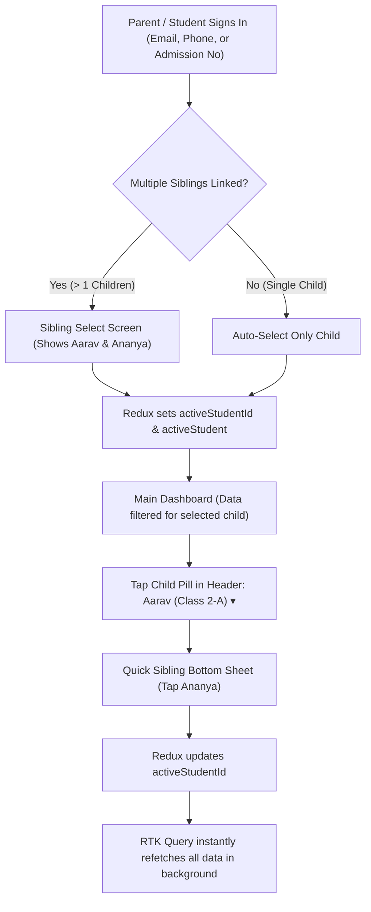

# CKR Schools: Student & Parent App Modernization & Sibling Mapping Plan

**Document Version:** 1.0  
**Target Domain:** `mobile/student_app` & `backend/src/domains/student_app`  
**Reference Playbooks:** `ckr-app-shell`, `ckr-frontend-native`, `ckr-phased-implementation`  
**Status:** Comprehensive Architecture & Implementation Plan  

---

## 1. Executive Summary & Objective

In Indian K-12 schools, the primary end-users of the student portal mobile app are **parents**. A significant portion of families have **two or more children (siblings)** enrolled in different grades within the same school (e.g. older child in Class 5, younger child in Nursery).

Currently, parents must log out and log back in with different credentials to view each child's timetable, fees, or report cards. 

### The Solution:
1. **Sibling Mapping & Fast Child Switcher**:
   - Single sign-on for parents using their phone number, email, or child's admission number.
   - At login, if multiple siblings are linked, display a **"Select Child" profile picker**.
   - Inside the app, a persistent **Child Context Pill** in the header (`Aarav (Class 2-A) ▾`) lets parents switch between siblings in 1 tap without logging out.
   - Global Redux state and API headers automatically scope all dashboard, attendance, timetable, fees, and marks data to the currently active child.
2. **App Shell Modernization (`ckr-app-shell`)**:
   - Bring `student_app` to full CKR parity with `teacher_app`.
   - Convert all `.tsx/.ts` files to clean **JavaScript only** (strictly no TypeScript).
   - Solid brand utility app bar with safe area top padding.
   - 5 focused 1-word bottom tabs: `Home`, `Class`, `Academics`, `Fees`, `Connect`.
   - Top-right Avatar pushes `Profile / Account`, freeing a tab slot for `Fees`.
   - All detail flows (`Fees`, `Attendance`, `CourseWork`, `Consents`, `LiveChat`) moved to `RootStack` so bottom tabs auto-hide.

---

## 2. Sibling Mapping Architecture

### 2.1 Database Relationships
PostgreSQL already contains the required relational tables:
1. `public.parents`: Parent contact details (`id`, `father_name`, `mother_name`, `phone`, `alternate_number`).
2. `public.student_parents`: Junction table linking `parent_id` ➔ `student_id`.
3. `public."user"`: Student user records (`admission_number`, `phone`, `father_name`, `mother_name`).
4. `public.class_students` & `public.class`: Links each student to their enrolled `class_name` and `section`.

### 2.2 Sibling Discovery Engine (Backend)
When a user logs in or requests siblings, the backend runs a dual-layer resolution:
- **Direct Linkage (Primary)**: Queries `student_parents` for all students associated with the parent's ID or the student's linked parents.
- **Demographic Match (Fallback)**: If `student_parents` junction was not manually created by admin, automatically matches students within the same `tenant_id` sharing identical parent phone numbers or father/mother names.

```sql
-- Sibling resolution query
SELECT 
  u.id, u.name, u.admission_number, u.avatar_url, u.dob, u.gender,
  c.id as class_id, c.name as class_name, c.section as class_section,
  cs.roll_number
FROM public."user" u
JOIN public.class_students cs ON u.id = cs.student_id AND cs.tenant_id = u.tenant_id
JOIN public.class c ON cs.class_id = c.id AND c.tenant_id = u.tenant_id
WHERE u.tenant_id = $1 
  AND u.type = 'student'
  AND (
    -- Linked via student_parents
    u.id IN (
      SELECT sp2.student_id 
      FROM public.student_parents sp1
      JOIN public.student_parents sp2 ON sp1.parent_id = sp2.parent_id
      WHERE sp1.tenant_id = $1 AND (sp1.student_id = $2 OR sp1.parent_id = $2)
    )
    OR
    -- Linked via parent contact matching
    u.phone = (SELECT phone FROM public."user" WHERE id = $2)
  )
ORDER BY c.name ASC, cs.roll_number ASC;
```

---

## 3. End-to-End User Experience & Flow



### 3.1 Post-Login Screen: `SiblingSelectScreen.js`
- Clean branded screen with school logo and welcome banner.
- Card list of all children:
  - Child photo/avatar with circular ring in school brand color.
  - Student full name, admission number, and roll number.
  - Class and Section pill (`Class 2 - A`).
- Tapping a card dispatches `setActiveStudent` and transitions to `MainTabs`.

### 3.2 In-App Child Switcher: `CustomHeader.js` & `SiblingPickerSheet.js`
- Located in the header across all primary screens.
- Pill: `[Child Avatar] Aarav (2-A) ▾`.
- Tapping opens a sleek bottom modal:
  - Lists all siblings with a checkmark on the currently active child.
  - 1-tap to switch: Updates Redux state, which immediately updates dashboard, timetable, attendance, and fee cards without full app restart.

---

## 4. Navigation Tree Modernization (`ckr-app-shell`)

Transform `mobile/student_app/src/navigation/` to comply with CKR Utility Shell standards:

```
RootStack (native-stack, headerShown: false)
│
├── AuthStack (when !isAuthenticated)
│   └── LoginScreen
│
└── AuthenticatedStack (when isAuthenticated)
    ├── SiblingSelectScreen (Modal / Screen when multiple siblings exist)
    │
    ├── Tabs (MainTabs — 5 Focused Operational Tabs)
    │   ├── HomeTab      → DashboardScreen
    │   ├── ClassTab     → TimetableScreen
    │   ├── AcademicTab  → ResultScreen (Exams & Report Cards)
    │   ├── FeesTab      → FeesScreen (Due balance, payment & history)
    │   └── ConnectTab   → CommunicationScreen (Chat, notices, circulars)
    │
    │── Detail & Workflow Screens (slide_from_right — Tab bar auto-hides!)
    │   ├── AttendanceScreen        (Monthly calendar, present/absent logs)
    │   ├── DateSheetScreen         (Exam schedule & timing)
    │   ├── CourseWorkScreen        (Homework, study materials & submissions)
    │   ├── ConsentsScreen          (Permission slips & digital approval)
    │   ├── CircularsScreen         (Official school notices & PDFs)
    │   ├── NewslettersScreen       (Monthly school publications)
    │   ├── GalleryScreen           (Event photos & celebrations)
    │   ├── LiveChatScreen          (1-on-1 chat with class teachers)
    │   └── AcademicCalendarScreen  (Annual holidays & planner)
    │
    └── Account & Profile (slide_from_right — Pushed by Top-Right Avatar)
        ├── ProfileScreen           (Student bio, parents info, admission details)
        └── ChangePasswordScreen    (Security & credentials)
```

---

## 5. API & Header Scoping Strategy

### Automated Header Injection via RTK Query
Instead of manually passing `studentId` into every frontend hook call, we configure `apiSlice.js`:
```javascript
// In mobile/student_app/src/store/apiSlice.js
prepareHeaders: (headers, { getState }) => {
  const token = getState().auth.token;
  const activeStudentId = getState().auth.activeStudentId;
  
  if (token) headers.set('authorization', `Bearer ${token}`);
  if (activeStudentId) headers.set('x-student-id', activeStudentId);
  return headers;
}
```

### Backend Middleware & Controllers
The backend student domain automatically reads `req.headers['x-student-id'] || req.query.studentId || req.user.id`:
- `GET /api/student_app/dashboard`
- `GET /api/student_app/timetable`
- `GET /api/student_app/attendance`
- `GET /api/student_app/fees`
- `GET /api/student_app/exams`
- `GET /api/student_app/course`
- `GET /api/student_app/consents/student`

---

## 6. Phased Implementation Steps

### Phase 1: Backend Sibling Discovery & Scoping
1. Add `getLinkedSiblings(tenantId, userId)` in `backend/src/domains/student_app/service.js` and `repository.js`.
2. Expose `GET /api/student_app/siblings`.
3. Enrich `POST /api/user/loginUser` to return `siblings` array and `activeStudent`.
4. Update `student_app` controllers to honor `x-student-id` header.

### Phase 2: Student App JavaScript & CKR Parity Clean-up
1. Convert `.tsx/.ts` files (`App.tsx`, `ConsentsScreen.tsx`, `components/`, `theme/`) to clean standard **JavaScript (`.js`)**.
2. Remove any stray TypeScript dependencies or configs.
3. Align theme tokens with `teacher_app` (`colors.js`, `shadows`).

### Phase 3: Redux Store & Sibling State
1. Update `authSlice.js` with `siblings`, `activeStudentId`, `activeStudent`, and `setActiveStudent`.
2. Configure `apiSlice.js` to inject `x-student-id`.
3. Add `tagTypes: ['ActiveStudentData']` so switching child automatically invalidates and refetches student data.

### Phase 4: Sibling Selection UI & Header Switcher
1. Build `SiblingSelectScreen.js` for post-login multi-child selection.
2. Build `SiblingPickerSheet.js` (bottom modal) inside `CustomHeader.js` for instant in-app switching.
3. Update `DashboardScreen.js` to show the active child's class, fee balance, and attendance.

### Phase 5: Navigation Refactor & Detail Screen Isolation
1. Refactor `RootNavigator.js` and `TabNavigator.js` to the 5-tab Utility Shell.
2. Move detail screens (`Fees`, `Attendance`, `CourseWork`, `Consents`, `LiveChat`) to `RootStack`.
3. Verify on Android emulator: smooth child switching, tab bar hiding, and zero crashes.

