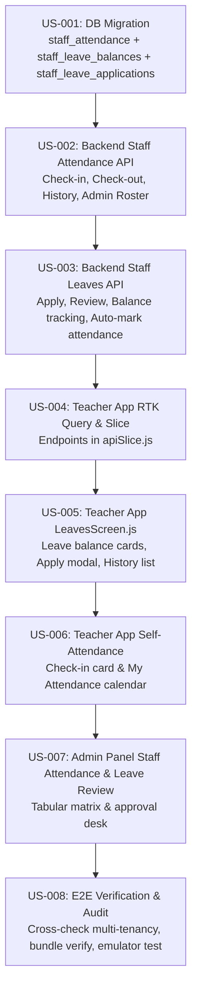

# CKR Schools v2 — Implementation Plan: Teacher Attendance & Leave Management Modules

**Plan ID:** `PLAN-TEACHER-ATTENDANCE-LEAVES-V1`  
**Date:** 2026-11-10  
**Project:** `ckr-schools-v2` (Multi-Tenant B2B SaaS)  
**Governing Agency:** CKR Technologies (Greater Noida, India)  
**Target Surfaces:**  
1. **Teacher Mobile App** (`mobile/teacher_app/` — React Native Bare CLI, Redux Toolkit + RTK Query)  
2. **Backend API** (`backend/` — Express 5 ESM, PostgreSQL raw SQL, Zod)  
3. **Admin Web Portal** (`web/admin_panel/` and `web/teacher_manager/` — React 19 Vite, Tabler Icons)  

---

## 1. Executive Overview & Business Workflow

The requirement consists of two tightly coupled operational modules:
1. **Teacher Self-Attendance Module:**
   - **Teacher App:** Teachers can check in / mark daily attendance (or Check-In & Check-Out with timestamp and self-declaration / location tag), view their attendance history calendar (Present, Absent, Half Day, Leave, Holiday), and view monthly statistics.
   - **Admin Panel:** Admins can view today's teacher attendance roster, track punch-in times, filter by department/role, mark/override teacher attendance manually, and export monthly attendance registers.
2. **Teacher Leave Application & Approval Module:**
   - **Teacher App:** Teachers can view their leave balances (Casual Leave, Sick Leave, Earned Leave), submit new leave requests with dates, reason, document attachment, and leave category, and track approval status (`Pending`, `Approved`, `Rejected`).
   - **Admin Panel:** Admins / Principals receive pending leave requests, review teacher replacement/proxy status, approve or reject with remarks. Upon approval, the system auto-marks the teacher's attendance as `Leave` for the sanctioned dates.

---

## 2. Architectural Blueprint & Database Design

Following CKR rule: Schema changes strictly via numbered migration files in `backend/migrations/` executed directly against PostgreSQL.

### Migration `013_create_staff_attendance_and_leaves_tables.sql`

```sql
BEGIN;

-- ============================================================================
-- 1. STAFF / TEACHER ATTENDANCE TABLE
-- Partitioned or indexed by (tenant_id, date) for multi-tenant scalability
-- ============================================================================
CREATE TABLE IF NOT EXISTS public.staff_attendance (
    id BIGSERIAL PRIMARY KEY,
    tenant_id UUID NOT NULL REFERENCES public.tenants(id) ON DELETE CASCADE,
    staff_id UUID NOT NULL REFERENCES public."user"(id) ON DELETE CASCADE,
    date DATE NOT NULL,
    status TEXT NOT NULL DEFAULT 'Present' 
        CHECK (status IN ('Present', 'Absent', 'Half Day', 'Leave', 'Holiday', 'Late')),
    check_in_time TIMESTAMPTZ,
    check_out_time TIMESTAMPTZ,
    source TEXT DEFAULT 'self_app' CHECK (source IN ('self_app', 'admin_override', 'biometric', 'system_leave')),
    marked_by UUID REFERENCES public."user"(id) ON DELETE SET NULL,
    remarks TEXT,
    ip_address TEXT,
    created_at TIMESTAMPTZ DEFAULT NOW(),
    updated_at TIMESTAMPTZ DEFAULT NOW(),
    CONSTRAINT uq_tenant_staff_attendance_date UNIQUE (tenant_id, staff_id, date)
);

CREATE INDEX IF NOT EXISTS idx_staff_att_tenant_date 
    ON public.staff_attendance(tenant_id, date);
CREATE INDEX IF NOT EXISTS idx_staff_att_tenant_staff 
    ON public.staff_attendance(tenant_id, staff_id, date);

-- ============================================================================
-- 2. STAFF LEAVE TYPES & ENTITLEMENTS (Per Academic Year)
-- ============================================================================
CREATE TABLE IF NOT EXISTS public.staff_leave_balances (
    id UUID PRIMARY KEY DEFAULT gen_random_uuid(),
    tenant_id UUID NOT NULL REFERENCES public.tenants(id) ON DELETE CASCADE,
    staff_id UUID NOT NULL REFERENCES public."user"(id) ON DELETE CASCADE,
    academic_year VARCHAR(30) NOT NULL DEFAULT '2026-27',
    casual_leave_total NUMERIC DEFAULT 12,
    casual_leave_used NUMERIC DEFAULT 0,
    sick_leave_total NUMERIC DEFAULT 10,
    sick_leave_used NUMERIC DEFAULT 0,
    earned_leave_total NUMERIC DEFAULT 15,
    earned_leave_used NUMERIC DEFAULT 0,
    unpaid_leave_used NUMERIC DEFAULT 0,
    created_at TIMESTAMPTZ DEFAULT NOW(),
    updated_at TIMESTAMPTZ DEFAULT NOW(),
    CONSTRAINT uq_tenant_staff_leave_balance UNIQUE (tenant_id, staff_id, academic_year)
);

CREATE INDEX IF NOT EXISTS idx_staff_leave_bal_tenant 
    ON public.staff_leave_balances(tenant_id, staff_id);

-- ============================================================================
-- 3. STAFF LEAVE APPLICATIONS
-- ============================================================================
CREATE TABLE IF NOT EXISTS public.staff_leave_applications (
    id UUID PRIMARY KEY DEFAULT gen_random_uuid(),
    tenant_id UUID NOT NULL REFERENCES public.tenants(id) ON DELETE CASCADE,
    staff_id UUID NOT NULL REFERENCES public."user"(id) ON DELETE CASCADE,
    leave_type TEXT NOT NULL CHECK (leave_type IN ('Casual Leave', 'Sick Leave', 'Earned Leave', 'Unpaid Leave', 'Half Day')),
    start_date DATE NOT NULL,
    end_date DATE NOT NULL,
    days_count NUMERIC NOT NULL DEFAULT 1,
    reason TEXT NOT NULL,
    attachment_url TEXT,
    status TEXT NOT NULL DEFAULT 'Pending' CHECK (status IN ('Pending', 'Approved', 'Rejected', 'Cancelled')),
    reviewed_by UUID REFERENCES public."user"(id) ON DELETE SET NULL,
    reviewed_at TIMESTAMPTZ,
    admin_remarks TEXT,
    created_at TIMESTAMPTZ DEFAULT NOW(),
    updated_at TIMESTAMPTZ DEFAULT NOW()
);

CREATE INDEX IF NOT EXISTS idx_staff_leave_apps_tenant 
    ON public.staff_leave_applications(tenant_id, status);
CREATE INDEX IF NOT EXISTS idx_staff_leave_apps_staff 
    ON public.staff_leave_applications(tenant_id, staff_id, created_at DESC);

COMMIT;
```

---

## 3. Backend API Contract (Domain: `staff_attendance` & `staff_leaves`)

Built under Domain-Driven Design (ESM):
`backend/src/domains/staff_attendance/` and `backend/src/domains/staff_leaves/` (or structured under unified `staff_operations`).

### Standard CKR Response Envelope
- Success: `{ success: true, data: ... }`
- Error: `{ success: false, error: { code: '...', message: '...' } }`

### Endpoints Specification

| Method | Endpoint | Access Role | Description |
|---|---|---|---|
| `GET` | `/api/staff-attendance/today` | Teacher | Get today's attendance status & check-in state for logged-in teacher |
| `POST` | `/api/staff-attendance/check-in` | Teacher | Teacher self-marks attendance (records check_in_time, IP/device) |
| `POST` | `/api/staff-attendance/check-out` | Teacher | Teacher marks check-out for the day |
| `GET` | `/api/staff-attendance/my-history` | Teacher | Fetch monthly calendar attendance data for logged-in teacher |
| `GET` | `/api/staff-attendance/admin/roster` | Admin/Principal | List today's staff attendance across school with filters |
| `POST` | `/api/staff-attendance/admin/override` | Admin/Principal | Admin manually marks/modifies a teacher's attendance |
| `GET` | `/api/staff-attendance/admin/monthly-matrix` | Admin/Principal | Full month matrix view of all teachers for payroll integration |
| `GET` | `/api/staff-leaves/my-summary` | Teacher | Get leave balance quota, used count, and active applications |
| `POST` | `/api/staff-leaves/apply` | Teacher | Submit new leave application |
| `DELETE` | `/api/staff-leaves/:id/cancel` | Teacher | Cancel pending leave application |
| `GET` | `/api/staff-leaves/admin/list` | Admin/Principal | List all leave requests (`Pending`, `Approved`, `Rejected`) |
| `POST` | `/api/staff-leaves/admin/:id/review` | Admin/Principal | Approve or Reject with remarks; on approval auto-fills `staff_attendance` |

---

## 4. Frontend Specifications

### A. Teacher Mobile App (`mobile/teacher_app`)

1. **Self-Attendance Screen (`AttendanceHomeScreen.js` / Sub-tab or Dedicated Feature):**
   - The "Attend" tab in bottom navigation currently handles Student Attendance.
   - We will enhance the teacher's dashboard and attendance navigation:
     - **Quick Punch Card on Dashboard:** Top card showing:
       - Status badge: `Not Checked In` / `Checked In at 08:15 AM` / `Present`
       - Action button: Large CTA `Check In Today` (with timestamp & confirmation)
     - **"My Attendance" History Screen:** Month calendar showing marked dots (Green for Present, Red for Absent, Blue for Leave, Orange for Half Day), plus monthly breakdown cards (e.g., Total Working Days: 24, Present: 22, Leaves: 2).
2. **Leave Management Screen (`LeavesScreen.js`):**
   - Transform the placeholder `LeavesScreen.js` into an interactive screen:
     - **Top Metric Cards:** Casual Leave (Used / Remaining), Sick Leave, Earned Leave.
     - **Primary CTA Button:** `+ Apply Leave` (opens high-polish modal with Date Range picker, Leave Type selector, Reason text input).
     - **Applications List (Tabs: `Pending`, `Approved`, `All`):** Card per application showing duration, status badge, applied date, and Admin review remarks.

### B. Admin Web Portal (`web/admin_panel`)

1. **Staff Attendance Tab in `/attendance`:**
   - Add a high-level segment switch at the top of `/attendance`: **[ Student Attendance ]** vs **[ Staff / Teacher Attendance ]**.
   - **Staff View Features:**
     - 4 Top KPI Tiles: `Total Teachers`, `Present Today`, `On Leave Today`, `Unmarked / Absent`.
     - CKR 5-Standard Tabular Table (38px single line rows, auto-sort, CSV export):
       - Teacher Name & Avatar, Department/Subjects, Punch-In Time, Punch-Out Time, Status Badge, Quick Override Dropdown (`Present`, `Absent`, `Half Day`, `Leave`).
2. **Staff Leave Approval Management (`/leaves` or dedicated section in Staff Roles):**
   - Dedicated table of pending leave requests with one-click **Approve** / **Reject** buttons and review remarks.
   - Live counter badge on sidebar nav item when pending leave requests exist.

---

## 5. Vertical Slicing & Implementation Plan (Story-by-Story)

Following the mandatory CKR Phased Implementation methodology:



### Detailed Slices:
- **Slice 1 (Database & Baseline Data):** Create migration `013_create_staff_attendance_and_leaves_tables.sql`, run by hand on PostgreSQL, verify schema and foreign keys.
- **Slice 2 (Backend Attendance Domain):** `routes.js`, `controller.js`, `service.js`, `repository.js`, `validation.js` with Zod validation and multi-tenant `tenant_id` scoping.
- **Slice 3 (Backend Leaves Domain):** Approval workflow with automatic attendance record insertion upon leave approval.
- **Slice 4 (Teacher App Leaves Module):** Replace placeholder `LeavesScreen.js` with full UI, connect to RTK Query hooks, test leave submission.
- **Slice 5 (Teacher App Self-Attendance):** Integrate check-in widget on Dashboard and "My Attendance" view.
- **Slice 6 (Admin Panel Integration):** Staff attendance view in admin panel and leave approvals table.
- **Slice 7 (Verification & Handover):** Emulator testing with teacher account (`t3` / `arct1`), admin approval verification in web panel, and React Native bundle check.

---

## 6. Adherence to CKR Standards & Guidelines

- **Language:** JavaScript only (ESM in Node.js, JSX in React & React Native). No TypeScript.
- **Envelope:** Uniform `{ success: true, data: ... }` / `{ success: false, error: ... }`.
- **Database:** Raw parameterized SQL (`$1, $2, ...`) using `pg` Pool. No ORMs.
- **Multi-Tenancy:** Mandatory `tenant_id` in every SQL query.
- **State Management:** Redux Toolkit + RTK Query in Teacher App.
- **UI Design:** Brand green `#0d5c3a`, 38px table rows in web, native feel with smooth animations and modal guards in mobile.

