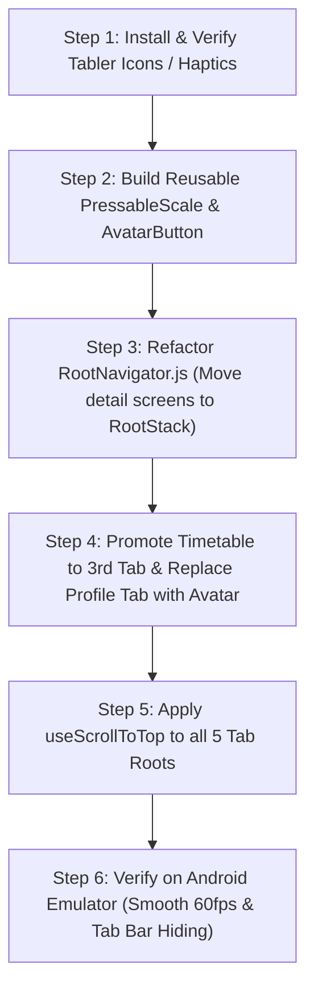

# CKR App Shell: Architecture & Implementation Proposal for Teacher App

**Document Version:** 1.0  
**Target Domain:** `mobile/teacher_app` (React Native Bare CLI, JavaScript)  
**Reference Skill:** `ckr-app-shell` & `ckr-frontend-native`  
**Status:** Architecture Proposal & Migration Blueprint  

---

## 1. Executive Summary & Shell Selection

According to Section 1 ("Pick the shell") of the `ckr-app-shell` standard:

```
Is the app used by end customers to browse/buy/book?
  └─ YES ➔ Consumer Shell (festive collapsing gradients, marquee offer tickers, banner carousels, search pill)
  └─ NO  ➔ Is it a work tool (vendor, rider, staff, teacher)?
             └─ YES ➔ Utility Shell (solid brand app bar, bottom tabs, top-right avatar → Account push)
```

The **Teacher App (`teacher_app`) is strictly a work tool / faculty operational app** used by teachers for fast, high-frequency daily workflows:
1. Morning staff self-attendance check-in/out and leave tracking.
2. Period-wise student roll call and attendance marking.
3. Exam marks entry and scholastic evaluation.
4. Timetable and period scheduling.
5. Direct messaging with school admin and parents.

### Verdict: The Teacher App MUST use the CKR **Utility Shell**
- **No festive marketing gradients or collapsing promo banners** (which belong to consumer shopping apps).
- **Solid brand app bar** using the active school's tenant primary color (`#065f46` emerald default).
- **Top-right Avatar pushes `Profile / Account` screen**, liberating one full bottom-tab slot.
- **5 focused 1-word bottom tabs** dedicated strictly to academic operations.
- **Full-screen detail flows on `RootStack`**, automatically hiding the bottom navigation bar during grading and roll-call.

---

## 2. Current Architecture vs. CKR Utility Shell Parity

| Dimension | Current Teacher App (`RootNavigator.js`) | CKR App Shell (`Utility Shell`) | Gap & Solution |
|---|---|---|---|
| **Tab Count & Slots** | 5 Tabs: `Home`, `Attend`, `Connect`, `Work`, `Profile` | Max 5 Tabs: `Home`, `Attend`, `Schedule`, `Work`, `Connect` | **Profile tab wastes 1 slot.** Move profile to top-right Header Avatar; promote **Schedule/Timetable** to primary tab. |
| **Tab Label Standard** | Mixed | Strictly **≤ 1 word** | Keep: `Home`, `Attend`, `Schedule`, `Work`, `Connect`. |
| **Tab Bar Visibility** | Detail screens (Leaves, Marks, Notes, Chat) live inside tab sub-stacks, keeping tab bar rendered. | Detail & flow screens live on **`RootStack`**; tab bar hides automatically on deep screens. | Relocate detail screens (`LeavesScreen`, `MarksEntry`, `ChatRoom`, etc.) to `RootStack`. |
| **Header System** | Fragmented headers across screens; hardcoded paddings and inconsistent back buttons. | Centralized **Utility Header** with `useSafeAreaInsets().top`, tenant logo, class context switcher, notifications, and avatar. | Adopt CKR `ShellHeader` (Utility variant). |
| **Tab Re-Tap Interaction** | No action on tapping active tab. | Re-tapping active tab calls **`useScrollToTop(ref)`** on root scroll/list view. | Add `useScrollToTop` refs to all 5 tab root screens. |
| **Card & Button Motion** | Standard `TouchableOpacity` with variable opacities. | **`PressableScale`** (scale to `0.97` on press with spring return) + light haptics. | Wrap KPI tiles, punch card, class cards with `PressableScale`. |
| **Icons Standard** | Feather icons (`react-native-vector-icons/Feather`) | Tabler Icons (`@tabler/icons-react-native`) with outline (inactive) & filled (active). | Align icons with CKR global Tabler standard. |

---

## 3. Proposed Navigation Tree

In compliance with CKR Hard Rules 2, 3, and 4:

```
RootStack (native-stack, headerShown: false)
│
├── AuthStack (when !isAuthenticated)
│   └── LoginScreen
│
└── AuthenticatedStack (when isAuthenticated)
    ├── Tabs (MainTabs — 5 Operational Tabs)
    │   ├── HomeTab      → DashboardScreen
    │   ├── AttendTab    → AttendanceHomeScreen
    │   ├── ScheduleTab  → TimetableScreen
    │   ├── WorkTab      → ExamsListScreen (Academics & Grading)
    │   └── ConnectTab   → ChatListScreen (Communication)
    │
    │── Detail & Workflow Screens (slide_from_right — Tab bar auto-hides!)
    │   ├── StaffAttendanceHistoryScreen (Teacher Self-Attendance Logs)
    │   ├── AttendanceMarkingScreen      (Student Roll Call)
    │   ├── AttendanceReportsScreen      (Student Attendance Analytics)
    │   ├── StudentProfileScreen         (Student Bio, Parents & History)
    │   ├── MarksEntryScreen             (Subject Marks Entry)
    │   ├── DateSheetScreen              (Exam Timetable)
    │   ├── CoScholasticGradingScreen    (Skill & Discipline Grading)
    │   ├── ClassResultsScreen           (Report Card / Tabulation)
    │   ├── ChatRoomScreen               (1-on-1 & Class Group Chat)
    │   ├── AnnualPlannerScreen          (Academic Calendar)
    │   ├── CourseWorkListScreen         (Syllabus & Materials)
    │   ├── CircularsScreen              (School Notices)
    │   ├── NewslettersScreen            (School News)
    │   └── GalleryScreen                (School Media)
    │
    │── Account & Settings (slide_from_right — Pushed by Top-Right Avatar)
    │   ├── ProfileScreen                (Teacher Bio, Designations, Subjects)
    │   ├── ChangePasswordScreen         (Security & Credentials)
    │   └── PayrollScreen                (Payslips & Salary Structure)
    │
    └── Modal Sheets (presentation: 'modal' or 'formSheet')
        ├── LeavesScreen                 (Apply for Leave & Quota Balances)
        ├── NotificationsScreen          (Alerts & Activity Stream)
        └── ClassPickerSheet             (Switch Academic Class Context)
```

> [!IMPORTANT]
> **Why this fixes the UI clutter:**  
> When a teacher is entering marks for 40 students or marking absent roll calls, having a 65px bottom tab bar visible wastes critical vertical screen real estate and causes keyboard collision bugs. Moving these screens to the `RootStack` ensures the bottom bar disappears automatically and returns smoothly when the teacher taps Back.

---

## 4. Header Architecture (CKR Utility Shell)

The Utility Header sits at the top of all 5 root tab screens.

### Header Layout Blueprint

```
┌────────────────────────────────────────────────────────────────────────┐
│ [Status Bar: light-content, padded by insets.top]                      │
│                                                                        │
│ [School Logo]  ARC Modern Academy        [Nursery - A ▾]  [🔔 2]  [👤] │
│   (28x28)       (Tenant Brand Name)       (Class Pill)    (Notif) (Avt)│
└────────────────────────────────────────────────────────────────────────┘
```

1. **Height & Insets:**
   - Background: `schoolInfo.themeColor` (e.g. `#065f46`).
   - Padding top: `useSafeAreaInsets().top`.
   - Fixed height: `56px` + `insets.top`.
2. **Left Element:**
   - Tenant School Round Logo (`28x28`, with fallback letter avatar).
   - School Name (`fontWeight: '700'`, truncated if needed).
3. **Right Controls:**
   - **Class Context Pill:** Displays active class (e.g. `Nursery - A ▾`). Tapping opens a quick bottom sheet to switch class context across the entire app.
   - **Notification Bell:** Badge shows unread alerts; tapping pushes `NotificationsScreen`.
   - **Teacher Avatar (`AvatarButton`):** Tapping pushes `ProfileScreen` on `RootStack`. Displays teacher photo or initials with an active online green dot.

---

## 5. Tab Bar Architecture & The 5-Tab Economy

Replacing the redundant `Profile` tab allows us to present a complete operational suite:

```
┌───────────┬───────────┬───────────┬───────────┬───────────┐
│   [ ⊞ ]   │   [ ☑ ]   │   [ 📅 ]  │   [ 📖 ]  │   [ 💬 ]  │
│   Home    │  Attend   │ Schedule  │   Work    │  Connect  │
└───────────┴───────────┴───────────┴───────────┴───────────┘
```

| Tab | Label | Primary Job | What Lives Here |
|---|---|---|---|
| **1. Home** | `Home` | Faculty overview & fast punch | Teacher Self-Attendance Card, Leave Balance widget, Quick Stats (Students, Exams, Events), Circulars carousel. |
| **2. Attend** | `Attend` | Student Attendance | Class roll call, quick status counters (Present / Absent / Leave), Student attendance history & percentage alerts. |
| **3. Schedule** | `Schedule` | Daily Routine & Lectures | Period-wise timetable, today's schedule, free periods, substitute lecture assignments, room allocations. |
| **4. Work** | `Work` | Academics & Assessments | Exams list, Marks entry, Co-scholastic grades, Homework, Study materials, Syllabus tracker. |
| **5. Connect** | `Connect` | School Communication | Chat list (Parents & Faculty), School circulars, Consent slips, Announcements. |

### Tab Bar Specifications:
- **Height:** `60px + insets.bottom`.
- **Background:** White / Surface (`#FFFFFF`) with subtle top border (`#E5E7EB`) and soft upward shadow (`elevation: 8`, `shadowOpacity: 0.06`).
- **Active Tint:** School Primary Color (`#065f46`).
- **Inactive Tint:** Muted Gray (`#9CA3AF`).
- **Icon Sizing:** `22px` with `animation: 'shift'` on React Navigation 7.

---

## 6. Motion & Feel Standards (CKR Polish)

In accordance with Section 6 of `ckr-app-shell`:

1. **`PressableScale` on Actionable Elements:**
   - All dashboard tiles, action buttons, student roster items, and punch cards wrap in `PressableScale`.
   - On press in: scale smoothly to `0.97` (duration: 120ms).
   - On release: spring back to `1.0` (damping: 15, stiffness: 250).
2. **Tab Re-Tap (`useScrollToTop`):**
   - When a teacher is scrolled deep into attendance lists or chat rooms and taps the active tab icon, the list instantly scrolls back to top.
3. **Light Haptics (`impactLight`):**
   - Punch In / Check Out confirmation.
   - Marking student as Absent (prevents accidental absent taps).
   - Submitting leave request.
4. **Skeletons over Full-Screen Spinners:**
   - Loading roster shows 5 pulsating student rows instead of an empty screen with an ActivityIndicator.

---

## 7. Migration Plan (Step-by-Step)



### Phased Execution:
1. **Phase 1 (Navigation Hierarchy):**
   - Update `mobile/teacher_app/src/navigation/RootNavigator.js`.
   - Move `LeavesScreen`, `StaffAttendanceHistoryScreen`, `MarksEntryScreen`, `ChatRoomScreen`, and `StudentProfileScreen` from internal tab stacks into the `RootStack`.
2. **Phase 2 (Header & Avatar Push):**
   - Create `AvatarButton.js` in `mobile/teacher_app/src/components/`.
   - Wire `AvatarButton` into `CustomHeader.js` to navigate directly to `Profile` on `RootStack`.
   - Update `MainTabs` to replace `Profile` with `Schedule` (`TimetableScreen`).
3. **Phase 3 (Micro-Interactions):**
   - Introduce `PressableScale.js` in `mobile/teacher_app/src/components/`.
   - Wrap the Teacher Attendance Punch Card and Dashboard KPI tiles with `PressableScale`.
   - Wire `useScrollToTop` on `DashboardScreen` and `AttendanceHomeScreen`.

---

## 8. Summary of Benefits for Teachers

1. **Zero Keyboard/Tab Clashing:** When teachers mark attendance or write student observation notes, the bottom tabs vanish, giving the keyboard full unobstructed room.
2. **Instant Timetable Access:** Timetable moves from being buried inside a dashboard grid icon to a dedicated 1-tap bottom tab (`Schedule`).
3. **Modern Blinkit/Zomato Class Polish:** Smooth card scale animations, instant scroll-to-top, and a unified top-right avatar account entry.
4. **Strict CKR Adherence:** 100% JavaScript (no TypeScript), native-stack performance, clean domain separation, and zero extraneous dependencies.

