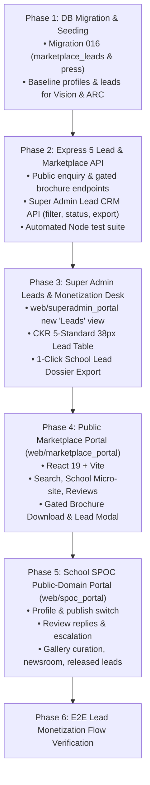

# CKR Schools v2 — Website Marketplace: User Stories & Phased Implementation Plan

**Document ID:** `CKR-DOC-MKT-USER-STORIES-V2-LEAD-MONETIZATION`  
**Governing Agency:** CKR Technologies, Greater Noida, India  
**Applicability:** Full Engineering & Client Delivery Team  
**Architecture:** Multi-Tenant B2B SaaS (Node.js Express 5 ESM + PostgreSQL + React 19 Vite + Redux Toolkit RTK Query)  
**Business Model:** Public Discovery + Pay-Per-Lead Monetization & Super Admin Value Bridge  

---

## 1. Core Business Rules (Updated)

1. **No Photo Uploads by Parents**:
   * Parents and public visitors **cannot** upload photos to the school gallery.
   * Campus galleries are populated **exclusively by the School Admin** (from internal school events, sports, and campus facilities).
   * Parents and alumni can **only submit star ratings and written reviews**.
2. **Centralized Lead Capture (Gated from Direct School Delivery)**:
   * Admission enquiries, brochure downloads, and school comparison requests **DO NOT** route directly to the school CRM in this phase.
   * All leads are captured into a central **Super Admin Marketplace Lead Engine** (`marketplace_leads`).
   * Purpose: The platform business team uses these verified leads to pitch school principals and coordinators, prove tangible enrolment ROI, and charge a pay-per-lead fee before releasing them.
3. **Lead Intent Tracking**:
   * **Direct Admission Enquiry**: Parent fills the admission inquiry form.
   * **Gated Brochure / Prospectus Download**: Parent enters Name + Phone number to download the school's official syllabus/fee guide.
   * **Comparison Intent**: Parent compares 2 or 3 schools; captured as a high-intent decision lead.

---

## 1.1 Current Implementation Notes (post-cleanup)

* **No demo/seed content**: the old marketplace seeder and all seeded profiles, Unsplash photos, reviews and press releases have been removed. Profiles render only real tenant data and real school-portal content.
* **School portal is the source of truth**: branding/contact (`tenants`, `school_settings`), gallery (`school_gallery`), achievements (`school_champions`, `student_of_the_week`) and highlights (`spotlight_of_the_day`, `thought_of_the_day`) are read directly from the school portal.
* **Public domain lives in a separate SPOC portal** (`web/spoc_portal`): the marketplace profile, publish/unpublish switch, gallery curation, newsroom, parent-review replies/escalation and released leads are managed by a `spoc` user, not by the school admin. The school operations portal (`web/admin_panel`) no longer edits marketplace content — it only links out to the SPOC portal.
* **Public enquiries stay anonymous**: admission enquiries, brochure downloads and multi-school enquiries require no login.
* **Ratings require login**: a parent/student signs in with the phone number and password provisioned by their school (`POST /api/marketplace/auth/login`). The reviewer name/phone are taken from the account, one review per account per school is allowed, and the `Verified` badge is shown only when the reviewer belongs to the reviewed school. Any logged-in user may submit a rating.
* **Live filters**: city and board filters are served by `GET /api/marketplace/facets`, so only cities/boards with listed schools appear.
* **Newsroom paused**: circular-to-press-release publishing is not surfaced on the public marketplace in this phase.
* **Honest empty states**: missing photos, fees, ratings, brochures and facilities are shown as "Photo not provided", "Fees on enquiry", "No reviews yet", etc. — never fabricated.

---

## 2. Flow Types & Priority Definitions

* **Flow Types:**
  * **Discovery:** School search by city, board, fee budget, and micro-site viewing.
  * **UGC:** 5-axis parent star ratings and verified written reviews.
  * **LeadGen:** Centralized lead capture (Enquiries, Gated Prospectus, School Comparison).
  * **LeadMonetization:** Super Admin Lead CRM, lead qualification, coordinator value pitch, and CSV export.
  * **Newsroom:** 1-click press release and circular publishing from School Admin.
  * **Governance:** School Admin profile settings and Superadmin moderation.

* **Priority:**
  * **P1 (Launch):** Core discovery, parent ratings/reviews, lead capture (Enquiry + Brochure), Super Admin Lead CRM, School Admin profile & press releases.
  * **P2 (Next Phase):** Multi-school comparison lead capture, review upvotes, automated WhatsApp alert to Super Admin on high-value leads.
  * **P3 (Later):** Automated school lead payment checkout (School pays ₹X online via Razorpay/Cashfree to unlock parent phone numbers).

---

## 3. Role-Wise User Story Tables

### 3.1 Role: Prospective Parent & Visitor (P)

| ID | User Story | Type | Pri |
|---|---|---|---|
| P1 | As a parent, I want to search schools by city, academic board (CBSE/ICSE/State), and annual fee budget so that I find schools suited for my child. | Discovery | P1 |
| P2 | As a parent, I want to view a school's public micro-site (`/schools/:slug`) with its verified logo, affiliation number, and official motto so that I can verify its authenticity. | Discovery | P1 |
| P3 | As a parent, I want to see real-time statistics (student strength band, certified faculty count, grades offered) so that I understand school scale without outdated brochures. | Discovery | P1 |
| P4 | As a parent, I want to browse official campus photos uploaded by the school (Classrooms, Labs, Sports) so that I can evaluate the school's infrastructure. | Discovery | P1 |
| P5 | As a parent, I want to submit a star rating (1–5) and written review so that I can share feedback about the school. | UGC | P1 |
| P6 | As a parent, I want to read verified reviews and see the 5-axis rating breakdown (Academics, Infrastructure, Faculty, Safety, Value for Money) so that I get honest feedback from other parents. | UGC | P1 |
| P7 | As a parent, I want to submit an admission enquiry form (Student Name, Parent Name, Phone, Email, Grade, Message) so that an admissions advisor connects with me. | LeadGen | P1 |
| P8 | As a parent, I want to enter my contact details to instantly download the school's official Prospectus & Fee PDF so that I can review detailed syllabus and rules. | LeadGen | P1 |
| P9 | As a parent, I want to read the school's latest press releases and academic achievements so that I stay informed on school milestones. | Newsroom | P1 |
| P10 | As a parent, I want to select 2 or 3 schools to compare their fees and facilities side-by-side so that I can decide between top options. | LeadGen | P2 |
| P11 | As a parent, I want to mark reviews as "Helpful" so that the community surfaces the most authentic parent feedback. | UGC | P2 |

---

### 3.2 Role: Community Contributor (Existing Parent / Alumni) (C)

| ID | User Story | Type | Pri |
|---|---|---|---|
| C1 | As an existing parent, I want to submit a rating and review so that other families learn about my experience. | UGC | P1 |
| C2 | As a parent with a registered phone number in the school system, I want my review to automatically display a `"Verified Parent"` badge so that it carries community trust. | UGC | P1 |
| C3 | As an existing parent or alumni, I want to upvote helpful reviews so that quality feedback is highlighted. | UGC | P2 |

---

### 3.3 Role: Platform Super Admin & Business Development (SA)

| ID | User Story | Type | Pri |
|---|---|---|---|
| SA1 | As a super admin, I want to see all marketplace admission inquiries in a central **Marketplace Leads Desk** so that no leads go directly to the school without platform monetization. | LeadMonetization | P1 |
| SA2 | As a super admin, I want to see leads generated via Gated Brochure Downloads (Parent Name, Phone, Grade, Target School) so that I capture high-intent parent interest. | LeadMonetization | P1 |
| SA3 | As a super admin, I want to filter leads by Target School, Date Range, Grade, and Status (`New`, `Contacted`, `Transferred`, `Converted`) so that our sales team tracks lead follow-ups. | LeadMonetization | P1 |
| SA4 | As a super admin, I want to add internal notes and set a lead monetization fee (e.g. ₹500/lead) so that we track revenue earned per lead. | LeadMonetization | P1 |
| SA5 | As a super admin, I want to export a branded **School Lead Dossier (CSV/PDF)** for any specific school coordinator so that I can contact the school, demonstrate platform value, and pitch them paid lead packages. | LeadMonetization | P1 |
| SA6 | As a super admin, I want to view a review moderation queue so that spam or offensive reviews can be rejected before publishing. | Governance | P1 |
| SA7 | As a super admin, I want to feature select partner schools on the marketplace homepage with a 1-click toggle so that promoted campuses receive prime placement. | Governance | P1 |
| SA8 | As a super admin, I want to track parents who compared schools (e.g. Vision vs ARC) so that we identify competitor decision leads. | LeadMonetization | P2 |

---

### 3.4 Role: School Administrator (A)

The school admin stays inside school operations. Public-domain content is **not** edited in the school portal — a dedicated SPOC portal owns it (see 3.5).

| ID | User Story | Type | Pri |
|---|---|---|---|
| A1 | As a school admin, I want my daily operations portal to stay free of public-marketing tasks so that fees, attendance and exams are never mixed with marketplace work. | Governance | P1 |
| A2 | As a school admin, I want to upload official high-resolution campus photos to our gallery so that the SPOC can curate them for the public listing. | Governance | P1 |
| A3 | As a school admin, I want a single link to the school's SPOC portal so that I can hand public content to the right person. | Governance | P1 |
| A4 | As a school admin, I want to create, edit, reset the password of and delete SPOC users from Staff Management → SPOC Users, so that I control who manages our public page. | Governance | P1 |

---

### 3.5 Role: School SPOC — Public Domain (S)

Signs in at the SPOC portal (`web/spoc_portal`, JWT `type = 'spoc'`). Every API call is tenant-scoped to the SPOC's own school.

| ID | User Story | Type | Pri |
|---|---|---|---|
| S1 | As a SPOC, I want to see a dashboard with rating, reviews due a reply, public photos and released leads so that I know what needs attention today. | Governance | P1 |
| S2 | As a SPOC, I want to edit the public profile (tagline, about, fees, facilities, badges, admission status, cover image, prospectus) so that the listing is accurate. | Governance | P1 |
| S3 | As a SPOC, I want to publish or unpublish our school on the marketplace so that we are never publicly listed by accident. | Governance | P1 |
| S4 | As a SPOC, I want to reply publicly to a parent review, remove my reply, and flag an abusive or fake review to CKR so that we protect the school's reputation honestly. | UGC | P1 |
| S5 | As a SPOC, I want to choose which campus photos appear on the public gallery so that only approved infrastructure photos are visible. | Governance | P1 |
| S6 | As a SPOC, I want to create, edit, publish and delete press releases in the public newsroom so that achievements and admissions news reach parents. | Newsroom | P1 |
| S7 | As a SPOC, I want to see only the leads CKR has released to my school, with contact details and a one-tap call, so that I can follow up without seeing CKR's commercial pipeline. | LeadMonetization | P1 |

---

### 3.6 Role: School Administrator (legacy, superseded)

Stories A1–A5 of the earlier draft (profile editor, brochure upload, admission-status toggle, circular → newsroom checkbox) are **replaced** by S2–S6 and were removed from the school portal.

---

## 4. Scope Summary & Story Counts

| Role | P1 (Launch) | P2 (Next Phase) | P3 (Later) | Total Stories |
|---|---|---|---|---|
| **Prospective Parent / Visitor (P)** | 9 | 2 | 0 | **11** |
| **Community Contributor / Alumni (C)** | 2 | 1 | 0 | **3** |
| **Platform Super Admin & Sales (SA)** | 7 | 1 | 0 | **8** |
| **School Administrator (A)** | 4 | 0 | 0 | **4** |
| **School SPOC — Public Domain (S)** | 7 | 0 | 0 | **7** |
| **Total** | **29** | **4** | **0** | **33** |

---

## 5. Database Schema: Centralized Lead Engine

### Table: `marketplace_leads`
```sql
CREATE TABLE IF NOT EXISTS public.marketplace_leads (
    id UUID PRIMARY KEY DEFAULT gen_random_uuid(),
    tenant_id UUID NOT NULL REFERENCES public.tenants(id) ON DELETE CASCADE,
    lead_type VARCHAR(50) NOT NULL DEFAULT 'enquiry', -- 'enquiry', 'brochure_download', 'comparison'
    student_name VARCHAR(150),
    parent_name VARCHAR(150) NOT NULL,
    phone VARCHAR(20) NOT NULL,
    email VARCHAR(150),
    grade VARCHAR(50),
    academic_year VARCHAR(20) DEFAULT '2026-2027',
    message TEXT,
    compared_tenant_ids JSONB DEFAULT '[]'::jsonb, -- Array of tenant UUIDs if comparison lead
    status VARCHAR(30) DEFAULT 'new', -- 'new', 'qualified', 'school_contacted', 'transferred', 'archived'
    monetization_fee_paise BIGINT DEFAULT 0, -- Fee in paise e.g. 50000 = Rs. 500
    admin_notes TEXT,
    ip_address VARCHAR(50),
    user_agent TEXT,
    created_at TIMESTAMPTZ DEFAULT NOW(),
    updated_at TIMESTAMPTZ DEFAULT NOW()
);

CREATE INDEX IF NOT EXISTS idx_mkt_leads_tenant ON public.marketplace_leads(tenant_id, status);
CREATE INDEX IF NOT EXISTS idx_mkt_leads_created ON public.marketplace_leads(created_at DESC);
CREATE INDEX IF NOT EXISTS idx_mkt_leads_phone ON public.marketplace_leads(phone);
```

### Table: `marketplace_press_releases`
```sql
CREATE TABLE IF NOT EXISTS public.marketplace_press_releases (
    id UUID PRIMARY KEY DEFAULT gen_random_uuid(),
    tenant_id UUID NOT NULL REFERENCES public.tenants(id) ON DELETE CASCADE,
    title VARCHAR(255) NOT NULL,
    summary TEXT,
    content_html TEXT NOT NULL,
    featured_image_url TEXT,
    category VARCHAR(50) DEFAULT 'General',
    published_date DATE DEFAULT CURRENT_DATE,
    source_circular_id UUID,
    is_published BOOLEAN DEFAULT TRUE,
    created_at TIMESTAMPTZ DEFAULT NOW(),
    updated_at TIMESTAMPTZ DEFAULT NOW()
);
CREATE INDEX IF NOT EXISTS idx_mkt_press_tenant ON public.marketplace_press_releases(tenant_id, is_published);
```

---

## 6. Phased Vertical Implementation Roadmap

Following CKR standard **Vertical Slicing** (`Database → Express API → RTK Query → UI Screen → Verification`):



### Phase 1: Database Migration & Baseline Seeding
* **Migration `016_marketplace_leads_and_press.sql`**:
  * Create `marketplace_leads` with `lead_type`, `status`, `monetization_fee_paise`, and `admin_notes`.
  * Create `marketplace_press_releases` for 1-click circular publishing.
* **Seed Data**:
  * Seed 8 realistic prospective parent leads across `vision` and `arc`:
    * 5 direct admission enquiries for Nursery, Grade 1, Grade 5, Grade 9.
    * 3 gated brochure downloads with parent phone numbers.
  * Seed authentic official gallery photos, facilities, and press releases.

### Phase 2: Express 5 Lead & Marketplace API
* **Public Endpoints**:
  * `GET /api/marketplace/schools` (Filters: city, board, fee range, search query).
  * `GET /api/marketplace/schools/:slug` (Aggregated live stats + facilities + gallery + press).
  * `POST /api/marketplace/schools/:slug/enquiry` (Inserts into `marketplace_leads`, NOT `newUsers`).
  * `POST /api/marketplace/schools/:slug/download-brochure` (Gated brochure capture → `marketplace_leads` with `lead_type = 'brochure_download'`).
  * `GET /api/marketplace/schools/:slug/reviews` & `POST .../reviews` (5-axis parent ratings).
* **Super Admin Lead Management Endpoints**:
  * `GET /api/superadmin/marketplace/leads` (Paginated, filtered by tenant, lead_type, status, date).
  * `PATCH /api/superadmin/marketplace/leads/:id` (Update status e.g. `school_contacted`, add notes, set monetization fee).
  * `GET /api/superadmin/marketplace/leads/export/:tenantId` (Generate CSV/PDF for school coordinator pitch).
* **Automated Verification**:
  * Node test script validating that leads land in `marketplace_leads`, are hidden from school CRM, and can be retrieved and updated by Super Admin.

### Phase 3: Super Admin Leads & Monetization Desk (`web/superadmin_portal`)
* **Dedicated "Marketplace Leads" View**:
  * **4 KPI Cards**:
    1. *Total Leads Captured*
    2. *Direct Enquiries*
    3. *Brochure Downloads*
    4. *Uncontacted / New Leads*
  * **CKR 5-Standard Tabular Data Table**:
    * 38px rows, `#064e3b` solid header, sortable columns.
    * Columns: `Date`, `Parent Name`, `Phone`, `Target School`, `Grade`, `Lead Type`, `Status Badge`, `Fee`, `Actions`.
    * Dedicated **Lead Detail Modal** with quick call button, status updater, and internal BD notes.
    * **"Export School Lead Dossier"** button (CSV/PDF) to send to the school principal/coordinator to prove value!

### Phase 4: Public Marketplace Portal (`web/marketplace_portal`)
* **React 19 + Vite App** (Port `5175`):
  * **Homepage (`/`)**: Hero search bar (Board, City, Budget), featured schools showcase, platform trust metrics.
  * **School Micro-site (`/schools/:slug`)**:
    * School hero banner with logo & verified badge.
    * Live auto-stats (Student band, faculty count, affiliation board).
    * Official campus photo gallery (uploadable only by school admin).
    * Press releases & media newsroom feed.
    * 5-Axis rating radar & verified parent reviews list + "Write a Review" modal.
    * **Gated Prospectus Download Button**: Opens modal asking Parent Name + Phone → submits lead to Super Admin → triggers PDF download.
    * **Sticky Admission Enquiry Drawer**: Captures parent contact details and routes straight to Super Admin Lead Engine.

### Phase 5: School SPOC Public-Domain Portal (`web/spoc_portal`)
* **React 19 + Vite app** (Port `5181`), same shell/design language as the school admin panel.
* **Auth:** `POST /api/user/loginUser` with a `spoc` account (`node backend/scripts/create_spoc_user.js <slug> <email> <password> "<name>"`). Non-SPOC accounts are refused by the portal.
* **API:** `/api/marketplace/manage/*` — every route authenticated and tenant-scoped from the JWT:
  * `GET /overview` — rating, replies due, public photos, released leads, profile completeness.
  * `GET|PUT /profile`, `PATCH /publish` — public profile and live/draft switch.
  * `GET /reviews`, `POST|DELETE /reviews/:id/reply`, `PATCH /reviews/:id/report`.
  * `GET /gallery`, `PATCH /gallery/:id` — curate `school_gallery.is_marketplace_visible`.
  * `GET|POST /press`, `PATCH|DELETE /press/:id` — public newsroom CRUD.
  * `GET /leads` — only leads CKR has released (`status = 'transferred'`), never BD notes or fees.
* **School portal cleanup:** public-domain editing never lives in `web/admin_panel`. `School Info` shows a **Public Marketplace** card that links out to the SPOC portal, and SPOC accounts are managed under Staff Management → **SPOC Users**. The duplicate `web/school_portal` app was deleted to remove the fork.
* **Public filters:** `marketplace_school_profiles.is_published` gates `GET /schools`, `/schools/:slug` and `/facets`; `school_gallery.is_marketplace_visible` gates the public gallery.

### Phase 6: E2E Verification & Production Gate
* End-to-end verification:
  1. Parent visits `http://localhost:5175/schools/vision`.
  2. Downloads prospectus by entering phone `9876543210` and name `Rahul Sharma`.
  3. Parent leaves a 5-star review.
  4. Parent submits admission inquiry for Grade 2.
  5. Verify that School Admin Admissions Desk (`newUsers`) does NOT receive the lead yet.
  6. Super Admin logs into `http://localhost:5173` → opens **Marketplace Leads** → instantly sees Rahul Sharma's enquiry + brochure download.
  7. Super Admin clicks "Export Lead Dossier" for Vision International School.
  8. Clean production build of all portals.
