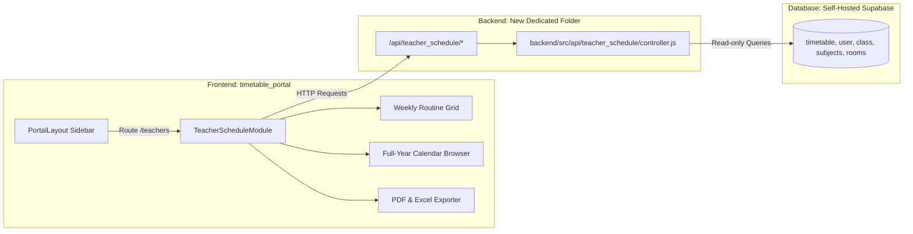

# 📋 Implementation Plan: Teacher-wise Classes Module

**Target Projects:** `timetable_portal` & `backend`  
**Client:** Vision International School  
**Date:** October 15, 2026  
**Status:** Ready for Review  

---

## 1. Strict Isolation & Zero Regression Policy

To ensure 100% stability of all current systems:
1. **No editing of existing backend controllers or routes:**
   - Files like `backend/src/api/shared/timetable/controller.js`, `admin_panel/routes.js`, etc., will **not** be modified.
2. **Dedicated New Backend Domain Folder:**
   - All new backend logic will reside exclusively in its own new folder:
     `backend/src/api/teacher_schedule/` (`routes.js` + `controller.js`).
   - Mounted cleanly as an independent API route: `/api/teacher_schedule`.
3. **No editing of existing portal scheduling pages:**
   - `TimeTable.jsx`, existing class calendar logic, and existing reducers remain completely untouched.
4. **Self-Contained Frontend Module:**
   - All new components and export logic live in a dedicated module folder inside `timetable_portal`:
     `timetable_portal/src/modules/teacher_schedule/`.

---

## 2. System Architecture & Flow

---

## 3. Dedicated Backend API Design (`backend/src/api/teacher_schedule/`)

A new, independent API folder providing optimized endpoints for teacher routines and full-year class aggregations:

| Method | Endpoint | Description |
|---|---|---|
| `GET` | `/api/teacher_schedule/teachers` | Returns list of all active teachers with contact info, subjects taught, and total assigned classes. |
| `GET` | `/api/teacher_schedule/:teacherId/routine` | Returns the recurring weekly routine (Mon–Sat) for the specified teacher (class, section, subject, room, time slot). |
| `GET` | `/api/teacher_schedule/:teacherId/yearly` | Returns all classes scheduled across the full academic year (or custom date range `?startDate=&endDate=`), grouped by month with total lecture count per class. |
| `GET` | `/api/teacher_schedule/workload-matrix` | Consolidated matrix of all teachers: weekly period count, busy slots, and free slots (for substitution). |

---

## 4. Frontend Module Design (`timetable_portal/src/modules/teacher_schedule/`)

A dedicated, isolated module containing:
1. **`TeacherSelectorBar.jsx`**: Fast search dropdown with teacher workload pills and view toggles (`Weekly Routine` vs `Full Year View`).
2. **`TeacherWeeklyRoutine.jsx`**:
   - Monday to Saturday visual timetable grid.
   - Shows Class, Section, Subject badge, Room, and Time Slot.
   - Free period indicators for quick substitution checks.
3. **`TeacherFullYearView.jsx`**:
   - Academic Year filter (e.g. *2025–2026*, *2026–2027*) & Month filter.
   - Summary statistics: Total lectures scheduled in the year, lectures per class, subject distribution.
   - Chronological session table/calendar with quick search.
4. **`TeacherExportService.js`**:
   - **PDF Generator:** Landscape A4 printable sheet with Vision International School logo, teacher header, routine grid, and signature block.
   - **Excel Generator:** Structured `.xlsx` workbook containing:
     - Sheet 1: Weekly Routine Grid
     - Sheet 2: Full-Year Scheduled Sessions Log
     - Sheet 3: Subject & Class Workload Breakdown

---

## 5. Detailed Implementation Phases

### 🔹 Phase 1: New Backend Module Setup (`backend/src/api/teacher_schedule/`) — ✅ COMPLETED
- Created new directory: `backend/src/api/teacher_schedule/`.
- Created `controller.js` with `getTeachersList`, `getTeacherWeeklyRoutine`, `getTeacherFullYearSchedule`, `getWorkloadMatrix`.
- Created `routes.js` with `auth` middleware protection.
- Registered `/api/teacher_schedule` in `backend/src/api/index.js` (clean 1-line mounting, zero changes to old controllers).
- **Verification:** Verified all 4 endpoints in Node against live Supabase database with HTTP 200 responses.

---

### 🔹 Phase 2: Frontend Service & API Client (`timetable_portal`) — ✅ COMPLETED
- Created `timetable_portal/src/services/teacherScheduleApi.js` with automated fallback to direct Supabase queries.
- Connects to `/api/teacher_schedule/*` with JWT authorization.

---

### 🔹 Phase 3: Export Engine (`teacherExportService.js`) — ✅ COMPLETED
- Created `timetable_portal/src/utils/teacherTimetableExport.js`.
- Implemented landscape printable PDF exporter (`exportTeacherRoutineToPDF`, `exportTeacherFullYearToPDF`) with school branding, period grid, and signature blocks.
- Implemented structured Excel exporter (`exportTeacherRoutineToExcel`, `exportTeacherFullYearToExcel`) using `xlsx`.

---

### 🔹 Phase 4: UI Components (Weekly Routine & Teacher Selector) — ✅ COMPLETED
- Created `TeacherSelectorBar.jsx` with teacher selection dropdown, quick workload pills, view switcher, and export buttons.
- Created `TeacherWeeklyRoutine.jsx` with Monday to Saturday routine grid, color-coded subject tokens, class badges, room indicators, and break styling.

---

### 🔹 Phase 5: Full-Year Browser & Analytics Mode — ✅ COMPLETED
- Created `TeacherFullYearView.jsx` with Academic Year selector, month pills, search filter, and chronological session table.
- Created `TeacherWorkloadMatrix.jsx` displaying all faculty workload capacity gauges and substitution lookup.
- Created `TeacherScheduleModule.jsx` as the master coordinator.

---

### 🔹 Phase 6: Navigation Integration & Production Build — ✅ COMPLETED
- Updated `PortalLayout.jsx` sidebar to include **"Teacher Schedules"** with `GraduationCap` icon pointing to `/teachers`.
- Attached `/teachers` in `App.jsx` to `<TeacherScheduleModule />`.
- Verified production build via `npm run build` in `timetable_portal` (exited code 0 in 3.6s, zero errors).

---

## 6. Safety & Non-Disruption Guarantees
- 🔒 **Zero Old Code Modified:** Existing backend timetable controllers (`/admin_panel/timeTable/*`) are left 100% intact.
- 🔒 **Zero Existing UI Changes:** Existing class scheduling calendar (`TimeTable.jsx`) continues to operate without changes.
- 🔒 **Isolated Deployment:** The new module can be enabled or disabled cleanly without impacting any other part of the system.
